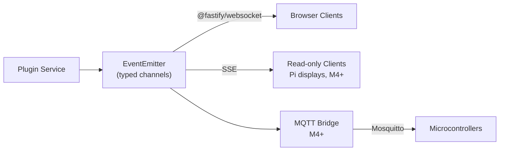

# Architecture

> Last updated: 2026-06-07 — packages/schemas added; packages/e2e creation milestone corrected.

---

## Contents

- [Topology](#topology)
- [Settled Decisions](#settled-decisions)
- [Plugin System](#plugin-system)
  - [Loading](#loading)
  - [Plugin Contract](#plugin-contract)
  - [Plugin Manifest](#plugin-manifest-shape)
- [Event Bus](#event-bus)
  - [Internal Flow](#internal-flow)
  - [Event Naming Convention](#event-naming-convention)
- [Data Storage](#data-storage)
- [Hosting](#hosting)
- [Platform API](#platform-api)
  - [Client Exports](#client-exports-family-osplatform)
  - [Server Exports](#server-exports-family-osplatformserver)
  - [Shared Types](#shared-types-family-osplatformtypes)
  - [Fastify Plugin Scoping](#fastify-plugin-scoping)
- [Auth](#auth)
- [Plugin Dev Toolchain](#plugin-dev-toolchain)
- [Testing](#testing)
  - [Stack](#stack)
  - [Conventions](#conventions)
  - [Package Layout](#package-layout)
- [To Be Defined](#to-be-defined)

---

## Topology


---

## Settled Decisions

All decisions below are locked. See `docs/decisions/` for full
rationale. Do not re-litigate — flag in session notes if revisit
is warranted.

| ADR | Decision                                                                                                                                                                                                         |
| --- | ---------------------------------------------------------------------------------------------------------------------------------------------------------------------------------------------------------------- |
| 001 | Plugin-native micro-frontend — first-party and community plugins share the same API and load path                                                                                                                |
| 002 | Two-layer currency — XP (gamification, never converts) and F$ (earnable, redeemable, real-money path)                                                                                                            |
| 003 | Age-tiered agency — four trust levels, parent-assigned, capability rules bound to levels not names                                                                                                               |
| 004 | WebSocket-first internally; Web Push for mobile parents; polling for external APIs                                                                                                                               |
| 005 | Allowance as ledger — system tracks balances, never moves real money; cashout is a parent-confirmed event                                                                                                        |
| 006 | TypeScript end-to-end — React shell, Node.js/Fastify plugin services                                                                                                                                             |
| 007 | Vite Module Federation for plugin loading — each plugin publishes a remoteEntry.js and manifest                                                                                                                  |
| 008 | In-process EventEmitter + @fastify/websocket bridge; MQTT bridge is a defined extension point for M4+                                                                                                            |
| 009 | PostgreSQL (Docker), single instance, per-plugin schemas; JSONB for semi-structured config                                                                                                                       |
| 010 | PWA for mobile (Android); Web Push for out-of-home notifications; no native app planned                                                                                                                          |
| 011 | Shell home surface is a composable, role-aware widget grid; M0 must not foreclose this model; implementation deferred to M1                                                                                      |
| 012 | shadcn/ui + Tailwind CSS v4 — component library and styling                                                                                                                                                      |
| 013 | State in layers: React Context (auth/tier), Zustand (shell), TanStack Query (server/plugin data)                                                                                                                 |
| 014 | Plugin design contract is import-based from `@family-os/ui` and `@family-os/platform`                                                                                                                            |
| 015 | Permissions layer on top of tier: effective permissions = tier baseline + grants − revocations; `TierGate` for coarse gating, `PermissionGate` for fine-grained                                                  |
| 016 | Monorepo tooling: pnpm workspaces + Turborepo; `apps/` for runnable services, `packages/` for shared libraries                                                                                                   |
| 017 | Auth session mechanism: `@fastify/session` + `connect-pg-simple`; cookie-based, server-side sessions; session stores active `profileId`                                                                          |
| 018 | CASL `(action, subject)` model for permission checks (extends ADR 015); `PERMISSION_REGISTRY` const for compile-time types + runtime enumeration; `@casl/prisma` `accessibleBy()` for row-level DB filtering     |
| 019 | ORM: Prisma; per-plugin `schema.prisma` files; `accessibleBy()` drives automatic row-level filtering in every module route                                                                                       |
| 020 | Plugin dev toolchain: Turborepo generator (`pnpm turbo gen plugin`); per-plugin Vite dev servers; no custom CLI                                                                                                  |
| 021 | Global family PIN stored in `system_config` (`key = 'family_pin_hash'`); family pseudo-profile is unattended default state                                                                                       |
| 022 | Widget system: React Grid Layout, six named sizes, widget manifest extends ADR 007/014, two-level role model (shell + widget), per-user layout as `{widgetId, x, y, w, h}[]`                                     |
| 023 | Test runner: Vitest (shares Vite pipeline); component tests: `@testing-library/react` + jsdom; route tests: `fastify.inject()`                                                                                   |
| 024 | E2E: Playwright; deferred to M1 shell-skeleton story; lives in `packages/e2e`                                                                                                                                    |
| 025 | Component catalog: Storybook 10 in `packages/ui`; ships in M0 dev-environment story                                                                                                                              |
| 026 | Test conventions: colocated test files; no enforced coverage thresholds; real PostgreSQL for integration tests (`familyos_test` DB separate from dev); shared test utils in `packages/test-utils`                |
| 027 | Environment configuration: `.env` files at repo root; `NODE_OPTIONS --env-file` for dev server; Vitest `envDir` for tests; `familyos` / `familyos_test` database separation                                      |
| 028 | Home surface default layouts: three tier-appropriate defaults (family pseudo-profile, tiers 1–2, tiers 3–4); Family Feed, Chores, Calendar are reserved modules; absent reserved slots render a placeholder card |
| 029 | All notifications flow through `platform.notify()`; platform routes to toast, tray, or Web Push based on priority and active profile tier; plugins never render their own toasts or push payloads                |

---

## Plugin System

### Loading

Each plugin publishes two files at a stable URL:

```
remoteEntry.js   — Vite Module Federation entry point
manifest.json    — plugin identity, schema ownership, routes, permissions
```

The shell reads the plugin registry at boot and lazy-loads each
plugin's remote module when the user navigates to its route.

### Plugin Contract

Plugins communicate with the platform exclusively via the **Platform
API** — a typed SDK injected at mount time. Plugins may not:

- Import from the shell or other plugins directly
- Read or write outside their declared Postgres schema
- Publish events outside their declared event namespace

### Plugin Manifest (shape)

```json
{
  "name": "chore-engine",
  "version": "1.0.0",
  "remoteEntry": "http://localhost:3001/remoteEntry.js",
  "exposes": ["./ChoreModule"],
  "routes": ["/chores"],
  "schema": "chore_engine",
  "events": {
    "publishes": ["chores.task.completed", "chores.task.created"],
    "subscribes": ["calendar.event.added"]
  },
  "widgets": [
    {
      "id": "chores.today-summary",
      "displayName": "Today's Chores",
      "component": "./widgets/TodaySummary",
      "defaultSize": "standard",
      "supportedSizes": ["compact", "standard"],
      "minTier": 1,
      "requiredPermission": "chores.view",
      "description": "Shows the current user's tasks due today."
    }
  ]
}
```

The `widgets` field is optional — plugins that only add routes do not need it. See ADR 022 for full widget manifest field rules, slot taxonomy, and role-aware composition model.

---

## Event Bus

### Internal flow



### Event naming convention

`module.noun.verb` — e.g. `chores.task.completed`, `finance.dollar.credited`

---

## Data Storage

- **Primary store:** PostgreSQL 16, Docker container
- **Schema isolation:** each plugin owns one schema; cross-schema reads/writes are forbidden
- **Semi-structured data:** JSONB columns within plugin schemas — no separate document store
- **Backups:** single `pg_dump` covers all plugin data
- **ORM:** Prisma (ADR 019); per-plugin `schema.prisma` files; `@casl/prisma` `accessibleBy()` for row-level filtering

---

## Hosting

- **Runtime:** Docker Compose on Ubuntu Server 24.04 LTS
- **Hardware:** repurposed x86 laptop (8GB+ RAM, SSD recommended)
- **Images:** multi-arch (`linux/amd64` + `linux/arm64`) from day one so Pi agents can pull the same images
- **Networking:** wired Ethernet preferred; server exposed on local network only
- **Future edge devices:** Raspberry Pi(s) running lightweight agents or SSE-connected displays

---

## Platform API

`packages/platform` uses subpath exports to serve browser and server consumers without cross-environment leakage:

| Subpath                      | Consumer          | What it exports                                               |
| ---------------------------- | ----------------- | ------------------------------------------------------------- |
| `@family-os/platform`        | Browser / plugins | React hooks, gate components, event bus hook                  |
| `@family-os/platform/server` | Node.js / Fastify | Fastify plugin factory, `EventBus` interface, `createAbility` |
| `@family-os/platform/types`  | Both              | Shared types only — no runtime code                           |

### Client exports (`@family-os/platform`)

```typescript
export function useAuth(): { id: string; name: string; tier: TierLevel }
export function useTier(): TierLevel
export function usePermissions(): AppAbility
export function AuthProvider(props: { children: ReactNode }): ReactElement

export function TierGate(props: {
  min: TierLevel
  fallback?: ReactNode
  children: ReactNode
}): ReactElement | null
export function PermissionGate(props: {
  action: string
  subject: string
  fallback?: ReactNode
  children: ReactNode
}): ReactElement | null

export function useEventBus(): {
  publish(event: EventName, payload: unknown): void
  subscribe(event: EventName, handler: (payload: unknown) => void): () => void
}
// Note: currently a callback-based dev hook in apps/shell. Promoted to
// @family-os/platform with this publish/subscribe shape in auth-and-profiles.
```

### Server exports (`@family-os/platform/server`)

```typescript
export function createEventBusPlugin(): FastifyPlugin
export function getEventBus(fastify: FastifyInstance): EventBus
export function createAbility(profile: Profile, overrides: PermissionOverride[]): AppAbility

export interface EventBus {
  emit(event: EventName, payload: unknown): void
  on(event: EventName, handler: (payload: unknown) => void): void
}
```

### Shared types (`@family-os/platform/types`)

```typescript
export type TierLevel = 1 | 2 | 3 | 4
export type EventName = `${string}.${string}.${string}`

export const PERMISSION_REGISTRY = {
  'platform.profile.view': {
    label: 'View profiles',
    module: 'platform',
    action: 'view',
    subject: 'platform.Profile',
  },
  'platform.profile.switch': {
    label: 'Switch active profile',
    module: 'platform',
    action: 'switch',
    subject: 'platform.Profile',
  },
  'platform.plugin.view': {
    label: 'Use plugins',
    module: 'platform',
    action: 'view',
    subject: 'platform.Plugin',
  },
} as const

export type PermissionString = keyof typeof PERMISSION_REGISTRY

export interface PluginManifest {
  name: string
  version: string
  remoteEntry: string
  exposes: string[]
  routes: string[]
  schema: string
  events: { publishes: EventName[]; subscribes: EventName[] }
  widgets?: unknown[] // typed WidgetManifest added by M1 widget system story (ADR 022)
}
```

### Fastify plugin scoping

All HTTP routes are registered under the `/api` prefix via a scoped sub-plugin. The WebSocket `/events` endpoint lives at root:

```typescript
await app.register(eventBusPlugin)           // /events — root, no prefix

await app.register(async (api) => {
  await api.register(authPlugin)             // /api/auth/*
  api.get('/health', ...)                    // /api/health
}, { prefix: '/api' })
```

**Gotcha:** plugins wrapped with `fastify-plugin` (e.g. `@fastify/session`, `@fastify/cookie`) break encapsulation — they apply globally regardless of which scoped sub-plugin registers them. This is intentional for decorators that must be visible everywhere (session, cookie), but means those plugins should be registered on the root `app`, not inside the `/api` scope, if their decorators are needed by multiple scopes. Route-only sub-plugins that do not use `fastify-plugin` stay properly scoped.

The Vite dev proxy maps these to the API server:

```typescript
proxy: {
  '/events': { target: 'ws://localhost:3000', ws: true },
  '/api':    { target: 'http://localhost:3000' },
}
```

---

## Auth

- **Mechanism:** `@fastify/session` + `connect-pg-simple` — server-side sessions in PostgreSQL (ADR 017)
- **Session payload:** `{ activeProfileId: string }` — resolved to a full `Profile` object by auth middleware on each request
- **Profile switching:** `POST /auth/switch { targetProfileId }` — unblocked if target tier ≤ current tier; 403 if target tier > current tier (requires `POST /auth/verify-pin { pin, targetProfileId }` first)
- **Reactive updates:** `AuthProvider` queries `/api/auth/me` via TanStack Query with key `['api/auth/me']`; `queryClient.invalidateQueries({ queryKey: ['api/auth/me'] })` on a successful switch re-renders all `TierGate` and `PermissionGate` trees without a page reload
- **M0 dev mechanism:** query-parameter or UI selector — real login/profile-switch UX is a separate design session (see queue)

**`platform` schema tables:**

```
profiles
  id          uuid  PK
  name        text
  tier        integer (1–4)
  avatar_url  text  nullable
  created_at  timestamptz

permission_overrides
  id           uuid  PK
  profile_id   uuid  FK → profiles.id
  action       text
  subject      text
  type         text  ('grant' | 'revocation')
  granted_by   uuid  FK → profiles.id nullable
  created_at   timestamptz

widget_layouts
  id           uuid  PK
  profile_id   uuid  FK → profiles.id
  widget_id    text
  x            int
  y            int
  w            int
  h            int

system_config
  key          text  PK
  value        jsonb
  updated_by   uuid  FK → profiles.id nullable
  updated_at   timestamptz
```

The family PIN is stored in `system_config` as `key = 'family_pin_hash'` (ADR 021). Other platform-wide settings (e.g. default widget layouts per tier) live here without requiring schema migrations.

Effective ability = `createAbility(profile, overrides)` — tier baseline rules + grant rows − revocation rows, built by `@family-os/platform/server`.

---

## Plugin Dev Toolchain

`pnpm turbo gen plugin` — Turborepo generator scaffolds new plugins (ADR 020). No custom CLI.

**What it generates:**

| File                                  | Purpose                                                                                  |
| ------------------------------------- | ---------------------------------------------------------------------------------------- |
| `plugins/[name]/vite.config.ts`       | Module Federation config; `@family-os/ui` and `@family-os/platform` as shared singletons |
| `plugins/[name]/public/manifest.json` | Stub matching `PluginManifest` type; served at `/manifest.json` by Vite                  |
| `plugins/[name]/tsconfig.json`        | Extends workspace root config                                                            |
| `plugins/[name]/src/index.ts`         | Barrel — exposes the plugin module                                                       |
| `plugins/[name]/src/Plugin.tsx`       | Minimal example using platform hooks                                                     |

`pnpm-workspace.yaml` is updated automatically. Each plugin runs its own Vite dev server; `pnpm dev` starts everything in parallel via Turborepo's task graph.

---

## Testing

### Stack

| Layer             | Tool                             | Notes                                                    |
| ----------------- | -------------------------------- | -------------------------------------------------------- |
| Test runner       | Vitest                           | Shares Vite pipeline; ESM-native; Turborepo-cacheable    |
| Component tests   | `@testing-library/react` + jsdom | Behavior-first; no snapshot tests                        |
| Route tests       | `fastify.inject()`               | Full request pipeline; no real HTTP                      |
| E2E               | Playwright                       | Scaffolded in M0 shell-skeleton; lives in `packages/e2e` |
| Component catalog | Storybook 10                     | In `packages/ui`; dev-only; not in build pipeline        |

### Conventions

- **Test files:** colocated with source (`Component.test.tsx`, `util.test.ts`)
- **Coverage:** no thresholds enforced — `packages/platform` and permission logic are high-priority targets by convention
- **Database:** real PostgreSQL for any test touching Prisma; tests run against a separate `familyos_test` database (never the dev `familyos` DB); `beforeEach` truncates test-relevant tables between runs (ADR 026, ADR 027)
- **Shared utilities:** `packages/test-utils` — custom RTL render with providers, profile factories per tier, synchronous event bus double

### Package layout

```
packages/
  schemas/        — shared Zod v4 schemas; consumed by shell, API, and plugins
  test-utils/     — shared test helpers, factories, doubles
  e2e/            — Playwright specs (created in M0 shell-skeleton)
  ui/
    .storybook/   — Storybook config
    src/**/*.stories.tsx
apps/
  shell/
    .storybook/   — shell-specific stories (not in packages/ui)
```

---

## To Be Defined

Deferred to later sessions:

- **External integrations** — Monarch, Greenlight, calendar sync (per module)
- **MQTT bridge design** — deferred to M4+ (Smart Home)
