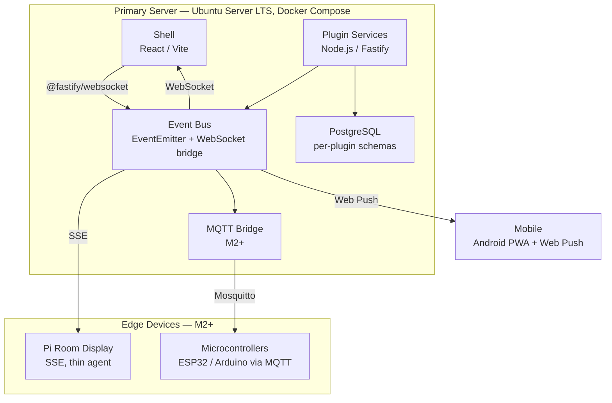

# Architecture

> Last updated: 2026-05-24 — Platform Architecture session.

---

## Contents

- [Topology](#topology)
- [Settled Decisions](#settled-decisions)
- [Plugin System](#plugin-system)
  - [Loading](#loading)
  - [Plugin Contract](#plugin-contract)
  - [Plugin Manifest](#plugin-manifest-shape)
- [Event Bus](#event-bus)
  - [Internal Flow](#internal-flow)
  - [Event Naming Convention](#event-naming-convention)
- [Data Storage](#data-storage)
- [Hosting](#hosting)
- [To Be Defined](#to-be-defined)

---

## Topology



---

## Settled Decisions

All decisions below are locked. See `docs/decisions/` for full
rationale. Do not re-litigate — flag in session notes if revisit
is warranted.

| ADR | Decision |
|-----|----------|
| 001 | Plugin-native micro-frontend — first-party and community plugins share the same API and load path |
| 002 | Two-layer currency — XP (gamification, never converts) and F$ (earnable, redeemable, real-money path) |
| 003 | Age-tiered agency — four trust levels, parent-assigned, capability rules bound to levels not names |
| 004 | WebSocket-first internally; Web Push for mobile parents; polling for external APIs |
| 005 | Allowance as ledger — system tracks balances, never moves real money; cashout is a parent-confirmed event |
| 006 | TypeScript end-to-end — React shell, Node.js/Fastify plugin services |
| 007 | Vite Module Federation for plugin loading — each plugin publishes a remoteEntry.js and manifest |
| 008 | In-process EventEmitter + @fastify/websocket bridge; MQTT bridge is a defined extension point for M2+ |
| 009 | PostgreSQL (Docker), single instance, per-plugin schemas; JSONB for semi-structured config |
| 010 | PWA for mobile (Android); Web Push for out-of-home notifications; no native app planned |
| 011 | Shell home surface is a composable, role-aware widget grid; M0 must not foreclose this model; implementation deferred to M1 |
| 012 | shadcn/ui + Tailwind CSS v4 — component library and styling |
| 013 | State in layers: React Context (auth/tier), Zustand (shell), TanStack Query (server/plugin data) |
| 014 | Plugin design contract is import-based from `@family-os/ui` and `@family-os/platform` |
| 015 | Permissions layer on top of tier: effective permissions = tier baseline + grants − revocations; `TierGate` for coarse gating, `PermissionGate` for fine-grained |

---

## Plugin System

### Loading

Each plugin publishes two files at a stable URL:

```
remoteEntry.js   — Vite Module Federation entry point
manifest.json    — plugin identity, schema ownership, routes, permissions
```

The shell reads the plugin registry at boot and lazy-loads each
plugin's remote module when the user navigates to its route.

### Plugin Contract

Plugins communicate with the platform exclusively via the **Platform
API** — a typed SDK injected at mount time. Plugins may not:
- Import from the shell or other plugins directly
- Read or write outside their declared Postgres schema
- Publish events outside their declared event namespace

### Plugin Manifest (shape)

```json
{
  "name": "chore-engine",
  "version": "1.0.0",
  "remoteEntry": "http://localhost:3001/remoteEntry.js",
  "exposes": ["./ChoreModule"],
  "routes": ["/chores"],
  "schema": "chore_engine",
  "events": {
    "publishes": ["chores.task.completed", "chores.task.created"],
    "subscribes": ["calendar.event.added"]
  }
}
```

---

## Event Bus

### Internal flow


### Event naming convention

`module.noun.verb` — e.g. `chores.task.completed`, `finance.dollar.credited`

---

## Data Storage

- **Primary store:** PostgreSQL 16, Docker container
- **Schema isolation:** each plugin owns one schema; cross-schema reads/writes are forbidden
- **Semi-structured data:** JSONB columns within plugin schemas — no separate document store
- **Backups:** single `pg_dump` covers all plugin data

---

## Hosting

- **Runtime:** Docker Compose on Ubuntu Server 24.04 LTS
- **Hardware:** repurposed x86 laptop (8GB+ RAM, SSD recommended)
- **Images:** multi-arch (`linux/amd64` + `linux/arm64`) from day one so Pi agents can pull the same images
- **Networking:** wired Ethernet preferred; server exposed on local network only
- **Future edge devices:** Raspberry Pi(s) running lightweight agents or SSE-connected displays

---

## To Be Defined

Deferred to later sessions:

- **M0 story breakdown** — M0 Product session (`docs/sessions/queue.md`)
- **Platform API surface** — typed SDK contract (M0 Architecture session)
- **Plugin dev toolchain** — scaffold, local dev server, hot reload
- **Auth / identity model** — login, session management, tier enforcement
- **Shell composition model** — widget system design, role-aware slot composition, plugin widget registration (ADR 011; M1 design session)
- **External integrations** — Monarch, Greenlight, calendar sync (per module)
- **MQTT bridge design** — deferred to M2+
